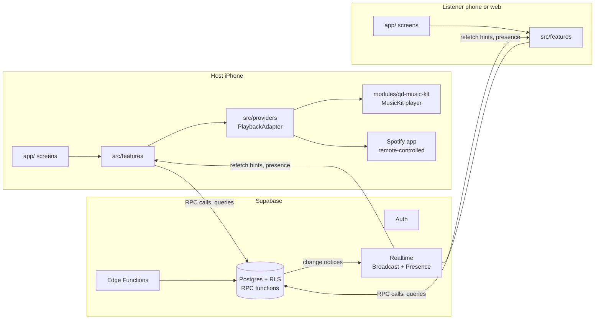

# q’d architecture

How q’d is built, where each piece of code belongs, and why each boundary exists. Product rules are in [PRODUCT_SPEC.md](PRODUCT_SPEC.md), contracts are in [API_CONTRACTS.md](API_CONTRACTS.md), and decisions are logged in [DECISIONS.md](DECISIONS.md).

> **Status, 2026-11-19.** Only the app shell and its quality gates exist so far: the Expo app, design tokens, components and mock screen shells (branches `feat/bootstrap`, `feat/design-tokens` and `feat/screen-shells`), plus lint, formatting, tests, CI and a pre-push hook (`feat/quality-gates`). All are in review. Everything marked **Planned** below is the target design, and it gets built by the Forge Trello card named next to it. When a card lands, change its status here in the same PR.

## 1. System overview



In one sentence: every phone reads and changes room state through Supabase, Postgres decides what's true, Realtime tells the other phones to refetch, and only the host's phone talks to a music player.

### What happens when someone adds a song

1. A listener taps **+** on a search result. The feature hook calls the `enqueue_recording` RPC with a fresh idempotency key.
2. Postgres checks sign-in, membership, room state, permission, capacity and the idempotency key. Then it assigns the queue position and inserts the entry.
3. The database sends a `queue.changed` broadcast on the room's private channel.
4. Every phone in the room, the host's included, refetches the queue through TanStack Query.
5. When the song's turn comes, the host's `PlaybackAdapter` resolves the provider track and plays it. The host reports the new playback state through an RPC, and the listeners' "Now playing" screens update the same way.

A broadcast that never arrives costs freshness but never correctness, because the next refetch reads the truth from Postgres.

## 2. Stack

| Concern | Choice | Status |
|---|---|---|
| App runtime | Expo SDK 58, React Native 0.88, React 19.3 | Built |
| Language | TypeScript, `strict`, path alias `@/*` → `src/*` | Built |
| Tooling | Node 22.13+ (Node 24 works), npm | Built |
| Navigation | Expo Router with typed routes | Built |
| Styling | React Native `StyleSheet` and tokens in `src/design`. No UI kit, no NativeWind. | Built |
| Fonts | Geist and Geist Mono (`@expo-google-fonts/*`) | Built |
| Visuals | expo-image, expo-blur, react-native-svg, `qrcode` (pure-JS QR encoder drawn with react-native-svg) | Built |
| Sharing | expo-clipboard and React Native `Share` (invite links) | Built |
| Server state | TanStack Query | Built: `src/services/queryClient.ts`, provided by `features/server-state/ServerStateProvider` in `app/_layout.tsx`. No screen queries Supabase yet |
| Ephemeral state | Zustand, only for small room and player state | Planned |
| Runtime contracts | Zod for env, RPC results and realtime payloads | Built for env (`src/services/env.ts`), domain schemas and realtime payload parsers (`src/domain`). Planned: RPC results (RPC contracts card) |
| Forms | React Hook Form | Not added yet: the email form validates with `validateEmailForm` (`src/domain/auth.ts`). Added when a longer form needs it |
| Interaction | Reanimated, Gesture Handler, a bottom-sheet library | Planned, added only where Figma needs them |
| Backend | Supabase Auth, Postgres, RLS, Realtime, Edge Functions, migrations | Client built (`src/services/supabase.ts`, created only when the env validates; untested against a live project). Auth built for email/password and Google (`src/services/auth.ts`, `features/auth`; untested against a live project and on a device). Rest planned · Supabase cards |
| Device storage | Supabase's recommended Expo session storage, plus SecureStore for provider credentials | Built: `expo-sqlite/localStorage` for the Supabase session (`sessionStorage.native.ts`; browser storage on the web), `expo-secure-store` for provider credentials (`providerCredentials.ts`; memory only on the web) |
| Apple playback | Local Swift Expo module around MusicKit | Planned · qd-music-kit card |
| Spotify playback | Spotify iOS SDK (App Remote) and the Web API | Web API remote built, untested on device (`src/providers/spotify`: PKCE sign-in with expo-web-browser and expo-crypto, tokens in SecureStore, refresh; `SpotifyPlaybackAdapter` over the Web API player endpoints). App Remote not used (open question in DECISIONS.md) |
| Tests | Jest/jest-expo, React Native Testing Library, Supabase integration tests, Maestro | Built: Jest, React Native Testing Library, `.maestro/` smoke flow (first runs with a development build), database tests on PGlite (`supabase/tests`, run by `npm test`). Planned: the same database tests against a Supabase local stack |
| Quality gates | ESLint, Prettier, `tsc`, Jest, Expo Doctor, GitHub Actions, Git pre-push hook | Built · `npm run check`, `.github/workflows/ci.yml`, `.githooks/pre-push` (every push) |
| Builds | EAS development, preview (internal) and production (TestFlight) profiles | Planned · EAS card |
| Observability | Redacting structured logger, privacy-filtered crash reports, opt-in analytics | Built: logger (`src/services/logger.ts`, `redact.ts`) and the crash-report filter (`crashReporting.ts`, no service connected yet). Planned: a crash-reporting service and analytics |

**Why this stack.** Two students, one fixed demo date and one Windows machine. Expo gives one codebase for iOS, the web and later Android, and the web build lets Baron work without a Mac. Supabase provides auth, a relational database with row-level security, realtime and serverless functions in one managed service, so there's no backend to operate. Both are mainstream enough to learn from, which is half the point of the project (see [LEARNING_PATH.md](LEARNING_PATH.md)).

**What we deliberately don't use:** microservices, a monorepo tool, Redux, GraphQL or a large UI kit. Each adds concepts without solving a problem this app has. The pitch deck's first-draft diagram (API gateway, WebSocket gateway, Redis, separate services) is superseded by Supabase.

## 3. Repository layout

```text
app/                      Expo Router screens and layouts (routes only)
  dev/                    Screen index and component gallery (development only)
  onboarding/             Three onboarding steps
  room/[code]/            Room screen plus its modal sheets
src/
  components/             q’d design-system primitives
  design/                 Tokens: colors, type, spacing, Now playing palettes, ThemeProvider
  domain/                 Pure types and logic: rooms, queue, recordings, matching
  features/               Feature modules: auth, onboarding, rooms, queue, search, settings
  providers/              Apple, Spotify and mock catalog/playback adapters      (interfaces, mocks, Apple/Spotify stubs and the Apple catalog search adapter built; Spotify connection and Web API playback built, untested on device; live Apple playback planned)
  services/               Supabase, env, flags, logging, analytics               (data mode, env, flags, logging, Supabase client, storage, query client and Edge Function calls built; analytics planned)
  test/                   Fixtures and provider contract helpers
modules/
  qd-music-kit/           Local Swift Expo module and config plugin             (planned)
supabase/
  config.toml             Supabase CLI settings for a local stack
  migrations/             Schema, RPC functions, triggers, RLS                   (schema built)
  functions/              Edge Functions                    (delete-account placeholder and catalog-search built)
    _shared/              Code functions share; can't import src/ (copies are test-checked)
  tests/                  Database and RLS tests on PGlite, plus the harness      (built)
  scripts/                Operator scripts run from a laptop, never the app      (demo reset built)
assets/icons/             The 34 Figma icons, unmodified SVG
docs/                     These documents and the pitch deck
```

Generated `ios/` and `android/` folders are ignored by git. See [§4.9](#49-generated-native-code-vs-committed-config).

## 4. Boundaries and why they exist

Each boundary below says what belongs on each side, the rule, and the reason. When code needs to cross one, change the boundary on purpose and record it in [DECISIONS.md](DECISIONS.md). Don't route around it.

### Import rules

| Folder | May import | Must not import |
|---|---|---|
| `app/` | `features`, `components`, `design`, `domain` | `services`, `providers` (go through a feature hook) |
| `src/features/` | `components`, `design`, `domain`, `services`, `providers` | `app/`, another feature's internals |
| `src/components/` | `design`, other components, `domain` types | `features`, `services`, `providers`, `app/` |
| `src/design/` | React and React Native only | anything else in `src/` |
| `src/domain/` | Zod | React, React Native, Expo, Supabase, any other `src/` folder |
| `src/providers/` | `domain`, `services` (logging, env, flags), `modules/qd-music-kit` | `features`, `components`, `app/` |
| `src/services/` | `domain` | `features`, `components`, `providers`, `app/` |
| `src/test/` | anything | — (production code must not import it) |

**Known exception.** Some screen shells still import sample data from `src/test/fixtures/mock-data.ts`. That file now only re-exports `src/providers/mock/data.ts`, the mock mode's sample data. It's temporary scaffolding: each screen card replaces the import with a feature hook backed by mock or real providers (the room screen, Up next and Add a song already read the room through `features/room/useRoom`, Add a song searches through `features/search/useCatalogSearch`, and Home, Start a room, Invite and the invite link route create, join and invite through `useStartRoom`, `useJoinRoom`, `useRoomInvite` and `useJoinByInvite`, backed by the mock RPCs in `features/room/mockServer.ts`). New code shouldn't add more imports from `src/test`.

ESLint enforces these rules (`no-restricted-imports` in `eslint.config.js`), so they don't depend on memory. The known exception is a fixed list of files there. Remove a file from that list once it stops importing `src/test`. ESLint doesn't catch one feature importing another feature's internals, so reviewers check that.

### 4.1 Screens vs. everything else (`app/`)

- **Rule:** a file in `app/` is a route. It reads route params, composes features and components, and navigates. It holds no business rules and makes no network or provider calls.
- **Why:** Expo Router turns every file in `app/` into a URL, so the folder has to stay a clean map of screens. Thin screens keep the Figma layout and the behavior separate. A redesign doesn't touch data code, and a data change doesn't touch layout. It also leaves room for a future SwiftUI client to copy the behavior from `features/` and `domain/` without untangling it from layout.
- Sheets (Up next, Add a song, Invite, Listeners) are modal routes under `/room/[code]/…`, so each one can be opened, linked and reviewed on its own.
- `app/dev/` (screen index and component gallery) is linked only in development builds (`__DEV__`).

### 4.2 Design tokens (`src/design/`)

- **Rule:** every color, font, size, radius and spacing value comes from here. Components don't hard-code values from Figma.
- **Why:** the Figma page `20 · Mobile` defines these as variables. Mirroring them in one place makes a Figma change a one-file change, and it keeps every screen visually consistent.
- **Now playing palette:** the accent, on-accent and three backdrop glows change with the playing song. `ThemeProvider` holds the current `NowPlayingPalette`, and screens set it with `useScreenPalette()` while they're focused. With nothing playing, the palette is `idlePalette`. The Figma sample modes live in `previewPalettes` as sample data only.
- **Provider artwork rule:** Apple may supply an artwork background color, and q’d may use it. Spotify screens use provider-neutral fallback colors unless Spotify explicitly supplies a permitted palette. Never analyze, crop or overlay provider artwork in ways provider policy forbids. So the palette for a song comes from the provider's metadata, not from pixel analysis.

### 4.3 Components (`src/components/`)

- **Rule:** components are presentational. They take props, read the theme, and render. They don't fetch data, call providers or know about rooms beyond the props they're given.
- **Why:** the same component appears on many screens and in the `/dev/components` gallery. Components without side effects are cheap to review against Figma and safe to reuse.
- Components that show a service (`ProviderBadge`, the rows in `rows.tsx`) take a `MusicProvider`, which only allows `apple_music` and `spotify`. That makes "YouTube Music: Ready" impossible to render by mistake.

### 4.4 Features (`src/features/`)

- **Rule:** a feature folder (`auth`, `onboarding`, `room`, `queue`, `search`, `settings`) owns its hooks, queries, mutations, forms and feature-specific UI pieces. It's the only layer that combines services, providers and components.
- **Why:** this layer is the "glue". Keeping the glue in one place per feature means screens stay thin, and services and providers stay reusable.
- Features talk to each other through `domain` types or a small exported hook. One feature doesn't reach into another's files.

### 4.5 Domain (`src/domain/`)

- **Rule:** pure TypeScript only. That means types (`MusicProvider`, `PlaybackMode`, `Room`, `QueueEntry`, `CanonicalRecording`, `TrackMatch` and so on), Zod schemas and pure functions such as matching scores, text normalization and room-code formatting. No React, no I/O.
- **Why:** this is the contract that the app, the providers, the database and a future SwiftUI client all agree on. Pure code is easy to unit-test, and the matching rules in particular need exhaustive tests (ISRC, durations, explicit/clean, version markers).
- Status: **Built** (domain types card): Zod schemas with inferred types for every shape in [API_CONTRACTS.md § 6](API_CONTRACTS.md#6-shared-domain-types) (`music-provider.ts`, `room.ts`, `recording.ts`, `queue.ts`, `playback.ts`, `primitives.ts`), and the versioned realtime payload parsers from [§ 4](API_CONTRACTS.md#4-realtime) (`realtime.ts`). Matching is built in `matching/` (matching card). `invite-link.ts` builds and parses QR invite links (Built · QR invitations card). Also **Built** (room screens stack): `room-rules.ts`, `time.ts`, `room-code.ts` (the room-code alphabet, input normalization and display), `room-name.ts` (1–40 characters, trimmed), `rpc-error.ts` (the § 2 error codes) and `invite.ts` (the app's invite links).

### 4.6 Providers (`src/providers/`)

- **Rule:** the only code that knows Apple or Spotify specifics. Everything else uses two interfaces from [API_CONTRACTS.md § Provider adapters](API_CONTRACTS.md#5-provider-adapters):
  - `CatalogAdapter`: search, resolve a link, get a track or playlist.
  - `PlaybackAdapter`: connect, prepare, play, pause, seek, enqueue, state, disconnect.
- **Why catalog and playback are separate:** anyone can search, but only the device that plays needs playback. A listener with no service still searches the canonical catalog. The host's device also needs playback. Splitting the two keeps that rule enforceable in the type system.
- **Why one interface for every provider:** Apple and Spotify work very differently. Apple plays inside q’d, and Spotify remote-controls the Spotify app. The rest of the app shouldn't care. One shared contract test suite runs against Apple, Spotify and the mock adapters.
- **Implementations:**
  - **Apple:** wraps `modules/qd-music-kit` (MusicKit `ApplicationMusicPlayer`, background audio, queue observation).
  - **Spotify:** controls an installed or active Spotify client through App Remote and the Web API. q’d never streams Spotify audio itself.
  - **Mock:** deterministic adapters for web and Windows development, UI work, automated tests and the demo fallback. They're labeled in the UI and switched by feature flags, so a mock can never pass for a live integration.
- **Spotify connection: Built, untested on device** (Spotify connection card): `spotify/auth.ts` (Authorization Code with PKCE, token refresh), `spotify/api.ts` (Web API client: bearer token, refresh once on 401, error codes) and `spotify/connection.ts` (Connect, status and Disconnect as a `ConnectionState`). `connectProvider` and `disconnectProvider` in `providers/index.ts` use it only with the `realSpotify` flag on.
- **Spotify playback: Built, untested on device** (Spotify playback card): `spotify/playback.ts`, a `PlaybackAdapter` that remote-controls the Spotify app over the Web API (devices, transfer, play by URI, pause, resume, seek, queue, state). `createPlayback('spotify')` returns it only with the `realSpotify` flag on. It passes the shared contract suite against a fake Spotify player. See [DECISIONS.md, 2026-11-25](DECISIONS.md).
- **Status: Built** (provider adapters card): both interfaces, `ProviderError`, the share-link parser, the mocks, and Apple Music and Spotify stubs that report "not in this build" until their cards land. The shared contract suite runs against all of them. See [API_CONTRACTS.md § 5](API_CONTRACTS.md#5-provider-adapters).
- `capabilities()` reports what each adapter can do (for example in-app audio, background playback or autoplay), and the UI asks it instead of checking which provider it is.

### 4.7 Services (`src/services/`)

- **Rule:** infrastructure with side effects: the Supabase client, environment validation, feature flags, the logger, analytics and crash reporting.
- **Why:** these are the places where data leaves the device. Putting them behind one folder means redaction, opt-in checks and environment validation happen in one place that's easy to review.
- **Logger rule:** structured logging redacts tokens, emails, room codes and listening history before anything is written or sent. Built: `log` in `src/services/logger.ts` redacts every entry with `src/services/redact.ts` before any sink sees it. Values under sensitive keys (`token`, `email`, `code`, `title`, `artist`, `queue` and so on) are replaced whole, and every other string is scanned for emails, room codes, JWTs, invite links, provider links and ids. Song titles in free text can't be recognized, so **log messages are fixed strings and data goes in the context object.** Use `log`, not `console`.
- **Crash reports:** `src/services/crashReporting.ts` sends nothing until a transport is set. Every event passes `beforeSend`, which keeps an allowlist of fields and redacts them. There's no session replay, no automatic breadcrumbs and no automatic event capture (`crashReportingPolicy`).
- **Env rule:** environment variables are validated with Zod at startup. The app fails fast with a clear message instead of misbehaving later.

### 4.8 Native module (`modules/qd-music-kit/`)

- **Rule:** all Swift and MusicKit code lives in this local Expo module and its config plugin. JavaScript reaches it only through the Apple `PlaybackAdapter` (and the Apple `CatalogAdapter` if search runs on the device).
- **Why:** native code needs a Mac, Xcode and a development build. Isolating it means the rest of the app still runs in Expo Go and on the web from Windows. Moussa owns this module, because it's Mac-only work.

### 4.9 Generated native code vs. committed config

- **Rule:** `ios/` and `android/` are generated by `expo prebuild` and never committed. Native settings (entitlements, background modes, the bundle ID `app.qd.mobile`) live in `app.config.ts` and config plugins.
- **Why:** a generated folder that's committed drifts from its config and causes merge conflicts between a Windows and a Mac teammate. Config-as-code keeps native behavior reviewable and reproducible.
- Android isn't configured yet (decision 2026-11-18). `owner` is added to `app.config.ts` when the repo is linked with `eas init`.

### 4.10 Client vs. server authority

- **Rule:** Postgres is the source of truth for rooms, membership, the queue and playback state. Every change goes through a server-side RPC (a Postgres function) that validates membership, room state, permission, capacity and idempotency. Clients never write those tables directly. RLS allows only reads to members.
- **Why:** several phones change one queue at the same time on flaky networks. If the server decides positions and permissions, two people adding at once can't corrupt the order, a retried request can't add a duplicate, and a modified client can't skip the host's rules.
- **Realtime is a notification layer, not a data layer.** Broadcast events tell clients what changed so they refetch. Presence shows who's here and whether the host is connected. If an event is lost, a refetch fixes it.
- Broadcasts are sent by the database, from inside the RPC that made the change (`private.broadcast_room_event()`), not by the client. That way no client can announce a change that didn't happen, and a rolled-back change announces nothing.
- **Built (Realtime Broadcast and Presence card), untested against a live project:** `src/services/realtime.ts` joins the room's private channel (`room:<room_id>`, presence keyed by user id), parses every broadcast with the versioned schema (`signalFor`; anything it can't read means "refetch the whole room", never a crash), tracks only `{ v, userId, role }` in presence, reports `connecting`/`online`/`offline`/`closed`, and reconnects with backoff (1 s doubling to 30 s), asking for a full refetch after a reconnect. `src/services/roomQueryKeys.ts` holds the TanStack Query keys and which ones each event invalidates. `features/room/useRoomRealtime` puts it together for a live room: invalidation, host presence (`hostPresentIn`/`nextHostPresence`), the host's own phone going offline counted as the host leaving, and `room.ended`. Mock mode keeps the mock store, which has the same signals (`endRoom`, `setOffline`) behind `/dev` toggles; the room screen shows "This room has ended" and "You’re offline" for both. Tests: `src/services/realtime.test.ts`, `features/room/useRoomRealtime.test.tsx`, `supabase/tests/realtime.test.ts` (what each RPC sends, payload privacy, who receives it), `__tests__/ui-states.test.tsx`.
- Built (enqueue_recording card): `enqueue_recording` (`supabase/migrations/20261125002000_enqueue_recording.sql`). It takes the room lock before assigning a position, so two people adding at once get one order, and `private.append_queue_entry()` is the one place an entry is added.
- Built (reorder/remove card): `reorder_queue` and `remove_queue_entry` (`supabase/migrations/20261125002200_reorder_remove_queue.sql`), checked against the control rule, with the adder's Undo.
- Built (enqueue_batch card), behind the `playlist_import` flag that's off: `enqueue_batch` and `undo_batch` (`supabase/migrations/20261125002100_enqueue_batch.sql`), the `private.feature_flags` table and `private.renumber_queue()`, which every RPC that takes entries out of the middle of the queue calls.
- Built (RPC contracts card): the shared checks, the error convention and the idempotency machinery live in the `private` schema (`supabase/migrations/20261124000200_rpc_foundation.sql`). Each RPC is a `security definer` function in `public` with a pinned `search_path`, and `anon` can't execute any of them.
- Built (join by code card): `join_room_by_code` (`supabase/migrations/20261125001000_join_room_by_code.sql`), with the attempt limits in `private.join_attempts` and `private.join_room()`, which every way of joining shares. Failed guesses are answered with `private.error_response()` so they're kept ([API_CONTRACTS.md § 1](API_CONTRACTS.md#1-conventions)).
- Built (QR invitations card): `create_room_invite` and `join_room_by_invite` (`supabase/migrations/20261125001100_room_invites.sql`). Tokens are generated in Postgres and stored only as hashes. The pure link helper is `src/domain/invite-link.ts`; the QR screen isn't built yet.
- Built (end_room card): `end_room` (`supabase/migrations/20261125001200_end_room.sql`). Host only. It ends the room, stops playback, frees and expires the code, revokes the invite and broadcasts `room.ended`.
- Built (demo account reset card): `reset_demo_accounts` (`supabase/migrations/20261125005000_reset_demo_accounts.sql`), operator only: `service_role` alone may execute it, and only where the `demo_reset` server flag is on. It ends the demo accounts' rooms through `private.close_room()`, the helper `end_room` now uses too, then clears those rooms' queues and memberships and the accounts' idempotency keys and join attempts. The script that calls it is `supabase/scripts/reset-demo-accounts.js`.

### 4.11 q’d sign-in vs. music-service authorization

- **Rule:** Supabase Auth handles q’d accounts (Apple, Google, email). Connecting Apple Music or Spotify is a separate flow that stores tokens on the device in SecureStore (built: `src/services/providerCredentials.ts`, Keychain entries readable after first unlock and never moved to another device; memory only on the web). The database's `provider_connections` table holds connection metadata only, never plaintext credentials.
- **Why:** most people in a room never play anything, so they never need a music service. Keeping the two flows separate lets guests skip it entirely, and it also keeps provider tokens out of the shared database.
- **Built (email/password, Google, callback, restore):** `/auth/callback` finishes PKCE redirects; live auth waits for the stored session before showing a screen. Google uses Supabase OAuth with PKCE through `expo-web-browser` (Expo Go), built but not verified on a device. `src/services/auth.ts` is the only code that calls `supabase.auth`, and maps every error to an `AuthErrorCode`. `features/auth/AuthSync` turns Supabase auth events into the session's state (signed out, onboarding, ready), which picks the route group in `app/_layout.tsx`. Sign-in is live only in live auth mode (`authMode` in `src/services/dataMode.ts`); otherwise the mock session signs in.
- **Built in mock mode:** Settings connects, changes and disconnects services (`features/connections`, `features/settings/ServicesSection`). A service counts as connected only when its adapter answers `connected`. Disconnecting the service a live hosted room plays through asks first and holds that room's player (`RoomPlayer.hold`) until the host reconnects. The real OAuth, revocation and `provider_connections` rows come with the provider cards.
- Server-side provider secrets (for example an Apple developer signing key or a Spotify client secret) live only in Edge Function secrets, never in the app bundle. Anything named `EXPO_PUBLIC_*` ships inside the app and is public.

### 4.12 Server state vs. ephemeral state

- **TanStack Query** caches everything that comes from Supabase: room, members, queue, search results. Realtime events invalidate those queries. The client (`src/services/queryClient.ts`) retries a failed query twice unless the error is permanent (an RPC error code such as `not_allowed`, or a 4xx), never retries mutations on its own (a retry must reuse the idempotency key), refetches when the app returns to the foreground, and logs failures redacted without the query key, since keys can hold room codes.
- **Zustand** holds small, short-lived state that never needs to reach the server, such as the local player's progress tick or which sheet is open.
- **React context** holds app-wide UI state that's already built: the theme palette (`ThemeProvider`) and, for now, the mock session (`MockSessionProvider`) and the mock rooms (`RoomsProvider`). The mock room store stands in for the queue rows in Postgres and follows the queue RPCs, so the Supabase cards swap it for TanStack Query without changing the screens.
- **Why:** server data has its own lifecycle (loading, stale, refetch, retry). Mixing it into a client store recreates that machinery badly. Keeping the client store tiny keeps the real state in one place.

### 4.13 Demo vs. production backend

- **Rule:** the demo uses a demo Supabase project. The public beta launches on a clean, separate production project. Demo data never migrates into production.
- **Why:** demo accounts, test rooms and debugging leftovers shouldn't sit beside real users' data. A clean project also proves the migrations can rebuild the schema from scratch.

## 5. Data model

Built · Initial Supabase migrations card (`supabase/migrations/20261124000100_initial_schema.sql`). Shapes are in [API_CONTRACTS.md](API_CONTRACTS.md). Every table has row level security switched on.

| Table | Holds |
|---|---|
| `profiles` | Display name, avatar color, 18+ confirmation. One row per auth user. |
| `provider_connections` | Which services a user connected and when. Metadata only, no credentials. |
| `rooms` | Room name, host, mode (`aux`/`sync`), state, the service the host plays through, the room code and its expiry, and the two room rules (who adds songs, who controls the music). |
| `room_rule_members` | The people the host chose for each rule set to "Chosen people". |
| `room_members` | Who is in which room, with their role. Enforces the 15-person cap. |
| `room_invites` | High-entropy QR invite tokens, separate from room codes. |
| `recordings` | Canonical recordings (title, artists, ISRC, duration, explicit flag). |
| `provider_tracks` | One provider's version of a song (provider + provider ID + metadata). |
| `track_matches` | The link from a recording to a provider track, with its confidence score. |
| `track_match_overrides` | "Wrong version?" corrections. Audited. |
| `queue_entries` | Server-assigned position, recording, added by, status, optional `batch_id`. Idempotency keys live in `idempotency_keys`. One `playing` entry per room. |
| `playback_states` | What's playing, from which position, at what time, paused or playing. Written by the host. |
| `playback_slots` | `sync (beta)` playback slots. Slot 1 is always the host. |
| `playlist_import_batches` | Post-demo playlist imports and their undo state. |
| `blocks`, `reports` | Beta moderation. |
| `analytics_events` | Opt-in events with no provider or song data. Keyed by an analytics id, not the user id. |
| `idempotency_keys` | One row per successful mutation: user, operation, key, a hash of the arguments and the stored result. Kept at least 24 hours. |

**RLS principle:** a signed-in user can read a room's data only if they're a member. Nobody inserts into, updates or deletes from room tables directly. Writes happen only through the RPC functions, which run with elevated rights after their own checks. The RLS tests prove an outsider can't read or change anything.

Built · RLS card (`supabase/migrations/20261124000300_row_level_security.sql`, tests in `supabase/tests/rls.test.ts`):

- Members read their room's rows in every room table. Only the host reads `room_invites`. Members see each other's profiles. The catalog (`recordings`, `provider_tracks`, `track_matches`) is readable by anyone signed in.
- `anon` holds no privilege on any table. Signed-in users hold no insert, update or delete privilege except on their own profile's onboarding fields, their own `provider_connections` rows and their own `blocks`, so a direct write to a room table fails with permission denied.
- `idempotency_keys` and `analytics_events` are never readable by clients.
- Realtime Authorization: members may receive on `room:<room_id>` and track presence there. Nobody may send a broadcast from a client.
- **Every new table** needs RLS switched on, no `anon` privileges and no write privileges for `authenticated`. Guard tests in `rls.test.ts` fail otherwise, because Supabase's default grants would expose it.

## 6. Playback in `aux`

- Only the host's device creates a `PlaybackAdapter`. Listeners' devices never play audio from q’d.
- The host plays the queue in order. After each change (play, pause, seek, skip, song end), it reports the state through an RPC. Listeners render "Now playing" and progress from that state.
- The host's player holds one song at a time, the room's now-playing entry (`features/room/RoomPlayer`). When it ends, the host calls `advance_queue` and loads the next entry. The player keeps no copy of the queue, so reorders and removals apply immediately. Built in mock mode; the real adapters follow the same pattern.
- **Apple Music:** plays inside q’d through MusicKit and keeps playing with the screen locked (background audio).
- **Spotify:** q’d tells the Spotify app what to play. The host needs Spotify installed and Premium for on-demand playback, and q’d stays in the foreground for the demo.
- **Switching services:** only between songs, never during one, and only after the host agrees (see [PRODUCT_SPEC.md § 6](PRODUCT_SPEC.md#song-not-on-the-hosts-service)). **Built in mock mode:** `src/domain/provider-switch.ts` decides what the host's phone does with the song that's up (`planSong`: play, offer a switch, or skip only) and whether a switch is allowed (`checkSwitch`). A song that isn't on the room's service never starts (`RoomPlayer.standBy`), so the switch happens before it plays. The room store's `switchProvider` stands in for `switch_playback_provider`, and `RoomPlayer` changes adapters only when a new song loads.
- **Host disconnect:** presence notices the host is gone. Everyone sees "Host reconnecting" for 30 seconds, and then the room pauses. The returning host refetches room state before resuming. **Built in mock mode** (host reconnecting card): the pure rule is `src/domain/host-presence.ts`; the room store holds the host's presence and whether the room paused for them; `RoomPlayer.hold` pauses the host's player; `HostNotice` shows the states. The `/dev` toggle stands in for Realtime Presence, which is planned (Realtime Broadcast and Presence card).
- **Autoplay:** when the queue ends, the provider may autoplay, and q’d labels it with the provider's name. **Built in mock mode:** the mock adapter autoplays a fixed list of songs and marks them `autoplay: true` in its state. `RoomPlayer` reports the end with `providerKeptPlaying`, `src/domain/autoplay.ts` decides whose songs they are (never in `sync`), the room store records `autoplay` (standing in for `report_playback_state` with status `autoplay`), and the room and mini player show "Autoplay by Spotify" or "Autoplay by Apple Music". Adding a song hands the room back to the queue.

## 7. Catalog and matching

- Apple's catalog is canonical. Search results become `recordings`. When a song has to play, the host's provider resolves a `provider_track` and stores a `track_match`.
- Matching is a pure function in `src/domain` (normalize, then score). The thresholds and rules are in [PRODUCT_SPEC.md § 6](PRODUCT_SPEC.md#6-catalog-and-matching). Results and overrides are stored in Postgres, so every phone sees the same answer and overrides are audited.
- **Built** (matching card): `src/domain/matching` (`text.ts` normalizes and reads version markers, `match.ts` ranks candidates and decides). `matchRecording(recording, candidates, { provider, overrideTrackId })` returns the `TrackMatch` to store, a status (`matched`, `needs_review` or `unavailable`), the reasons and every candidate ranked for "Wrong version?". The numbers are in [DECISIONS.md](DECISIONS.md) (2026-11-24 · Track matching).
- **Built** (canonical search card): search runs in the `catalog-search` Edge Function (open decision 1). It holds the Apple Music API developer token, searches Apple's catalog, normalizes each song (`supabase/functions/catalog-search/apple.ts`) and saves it with `save_catalog_tracks` as an Apple `provider_tracks` row plus a canonical `recordings` row, found again by `recordings (source_provider, source_track_id)`. The app calls it through `services/edgeFunctions.ts` and the Apple `CatalogAdapter` (`providers/apple/catalog.ts`), and `features/search/useCatalogSearch` debounces it. Mock mode still uses the mock catalog. **Built, untested against the live Apple Music API**: the team has no developer key yet.
- **Built** (availability and low-confidence states card, mock mode): `src/domain/availability.ts` turns a stored `TrackMatch` into what the room shows and whether the host's phone may play it. Search results, queue rows, the room's now-playing notice and the mini player follow it. Since the integration of the room-states and provider-UI stacks, the stored matches feed `availableOn` → `planSong`, and `RoomPlayer.standBy` is the one path for a song that can't start (unavailable or unmatched). Mock fixtures get their matches from `matchRecording` against made-up candidates (`src/providers/mock/matches.ts`). The "Wrong version?" button is a prop on `MatchNotice` that the override card passes.
- Planned · Storing `track_matches` when playback needs a mapping (the queue and playback cards call `matchRecording`).

## 8. Configuration, environments and flags

- `app.config.ts` holds the app name `q’d`, the slug and scheme `qd`, the bundle ID `app.qd.mobile`, portrait orientation, a dark interface, typed routes and plugins.
- `.env.example` lists variable names only. Real values live in `.env` (ignored by git) and in EAS secrets.

**Environment.** `src/services/env.ts` validates every variable with Zod at startup. Nothing is required: with no `.env` the app runs on labeled mock data. A missing or invalid value is reported by variable name (never by value) in a development warning, and that part falls back to its safe default instead of crashing. `EXPO_PUBLIC_DATA_MODE=live` without valid Supabase values falls back to mock, and so does `live` until the live data cards land (`LIVE_DATA_AVAILABLE` in `dataMode.ts`). The Supabase key must be the publishable (or legacy `anon`) key: a secret or service-role key is rejected, because every `EXPO_PUBLIC_*` value ships inside the app.

**Feature flags** (built · `src/services/flags.ts`, set with `EXPO_PUBLIC_FLAG_*`). These are the switches that keep unfinished or blocked features off:

| Flag | Default | Why it exists |
|---|---|---|
| Real Apple Music | off until the MusicKit bridge works on a device | Lets the mock stand in during development and as a demo fallback |
| Real Spotify | off until Spotify `aux` works on a device | Same, plus the five-user development-mode limit |
| `sync` | off, private, locked | Blocked until providers and a legal review approve it. The build ignores `EXPO_PUBLIC_FLAG_SYNC`, and `enabledPlaybackModes()` returns only `aux` |
| Playlist import | off | Post-demo feature. Server side: `private.feature_flags` row `playlist_import` (enqueue_batch card) |
| Moderation | off for the demo, on for the beta | Beta gate |
| Analytics | off, and opt-in when on | Privacy. `analyticsAllowed()` needs the flag and the person's opt-in |
| Demo reset | off; on only in the demo project | Server only: `private.feature_flags` row `demo_reset` lets `reset_demo_accounts` run (demo account reset card), so the same migration can't reset anyone in production |

## 9. Where the app runs

| Target | Used for | Limits |
|---|---|---|
| **Expo Go** on a phone | Reviewing the UI with mock data, from Windows or the Mac | No MusicKit, no Spotify SDK, no custom native code. Expo Go must support SDK 58. |
| **Web** (`npm run web`) | UI and backend work on Windows with mock providers | No native modules. Some visual effects (blur) differ. |
| **Development build** (EAS or `npx expo run:ios`) | Anything native: MusicKit, Spotify, background audio | Needs the EAS profiles. Building iOS locally needs the Mac. |
| **TestFlight** | Internal testing, demo day, public beta | Apple review for external testers |

The screen shells use only modules that ship inside Expo Go (expo-image, expo-blur, react-native-svg, expo-font, expo-clipboard) plus pure-JavaScript packages (`qrcode`). Keep it that way for UI code until the development build exists, so Baron can review in Expo Go.

## 10. Testing strategy

Jest, React Native Testing Library and the Maestro folder are set up. Each feature card adds its own tests. Unit tests sit next to their code as `*.test.ts(x)`. Route tests live in `__tests__/`, because every file under `app/` becomes a route.

| Layer | Tool | What it proves |
|---|---|---|
| Domain | Jest | Matching (ISRC, durations, explicit/clean, version tokens; Built: `src/domain/matching/rules.test.ts`), room-code formatting, queue ordering helpers |
| Providers | Shared contract suite in `src/test` (Built: `src/test/providerContract.ts`) | Apple, Spotify and mock adapters behave the same through the interface |
| Database | Jest + PGlite in `supabase/tests` (see below) | RLS denies outsiders, host/member permissions, idempotent enqueue/reorder/remove, concurrent adds, code collisions, expiry and rate limits |
| Components and screens | React Native Testing Library | Loading, offline, empty, unavailable, reconnecting and provider-required states (Built: `__tests__/ui-states.test.tsx`, one describe per state, plus the per-card route tests) |
| End to end | Maestro | Smoke flows: sign in, create a room, join, add a song |
| Physical devices | Manual checklist | [PRODUCT_SPEC.md § 2](PRODUCT_SPEC.md#demo-must-haves) and [DEMO_RUNBOOK.md](DEMO_RUNBOOK.md) |

### Database tests

There's no Docker or Supabase CLI on Windows, so the database tests run on [PGlite](https://pglite.dev), Postgres compiled to WebAssembly, inside Jest. `npm test` runs them with the app tests (Jest project `db`), so CI and the pre-push hook run them too.

- `supabase/tests/harness/db.ts` creates a fresh in-memory database per test file: it loads `harness/supabase-shim.sql` and then every file in `supabase/migrations` in filename order. Reuse it for every database card.
- The shim stands in for what Supabase provides: the `anon`, `authenticated` and `service_role` roles with Supabase's default grants, `auth.users`, `auth.uid()` (read from `request.jwt.claim.sub`), and `realtime.messages`/`realtime.send()`. It's test-only and never applied to a project.
- `db.as(user)` runs SQL or an RPC the way PostgREST does, as `authenticated` with the user's id in the JWT settings, so RLS and `security definer` functions run for real. `db.asAnon()` and `db.asServiceRole()` cover the other roles, and `db.query()` runs as the superuser for setup and checks.
- `harness/pglite-transform.js` lets PGlite load inside Jest without `--experimental-vm-modules`. `supabase/tests/tsconfig.json` gives the tests Node types; the app's `tsconfig.json` leaves `supabase/tests` and `supabase/functions` out, and `npm run typecheck` checks both.
- Like PostgREST, the harness commits an RPC that sets `response.status` to 400 or more and returns normally, then throws a `DbError` built from the body it returned (`private.error_response()`).
- PGlite runs one connection, so true concurrency can't be tested here. Requests fired together queue behind PGlite's mutex and run as whole transactions one after another. Built (queue concurrency card, `supabase/tests/queue-concurrency.test.ts`): bursts of simultaneous adds, retries, reorders and removals from several members, plus a seeded 300-operation random burst, check the queue invariants (one playing entry at 0, queued positions 1..n with no gaps or repeats, every success applied once, replays identical). A structural test checks that every queue RPC takes the room lock before touching the queue, and another that `private.lock_room` holds the row for the transaction. Proving that the lock blocks a second backend needs the Supabase local stack. The same tests should also run against a Supabase local stack (`supabase start`) on a machine with Docker. PGlite is Postgres 18; `config.toml` asks the CLI for 17.

## Sync (beta) research

Post-demo, private, behind the `sync` flag. Nothing here ships publicly without provider and legal approval.

- The server keeps a timeline. Each slot's device prepares the mapped recording before a future `targetStartAt`.
- Devices report ready or unavailable, then periodic progress.
- Only slots that are ready start. The others show "Catching up" or "Sitting out".
- Drift under about 750 ms is acceptable for remote or headphone listening. Above about one second, the device corrects with a seek or restart the provider supports.
- This is never described as sample-perfect.

## Open technical decisions

Record each answer in [DECISIONS.md](DECISIONS.md) and update this file.

1. **Where canonical (Apple catalog) search runs.** Guests without Apple Music, and Android or web clients, can't use on-device MusicKit search. An Edge Function holding an Apple Music API developer token would serve everyone the same results. On-device MusicKit is simpler but works only on iOS. **Decided 2026-11-25 (canonical search card): an Edge Function**, so guests, Android and the web search the same catalog. See DECISIONS.md.
2. **How broadcasts are sent.** Decided 2026-11-24 (RPC contracts card): the RPC itself sends it, through `private.broadcast_room_event()` and `realtime.send()`. See [API_CONTRACTS.md § 4](API_CONTRACTS.md#4-realtime).
3. **Queue position representation.** Decided 2026-11-25 (enqueue_recording card): dense integers. Queued entries are `1..n` in play order, the playing entry is `0`, and only RPCs renumber them, under the room lock. See [API_CONTRACTS.md § enqueue_recording](API_CONTRACTS.md#enqueue_recording). Clients never compute positions.
4. **Bottom-sheet library.** Pick one only when an interaction needs gestures that a modal route can't provide.
5. **Future SwiftUI client.** After the demo, a SwiftUI client is planned against the same Supabase schema and contracts. The React Native app stays as the reference client and the eventual Android path, and the backend isn't rewritten. This is why `domain/` and the RPC contracts are kept platform-neutral.
